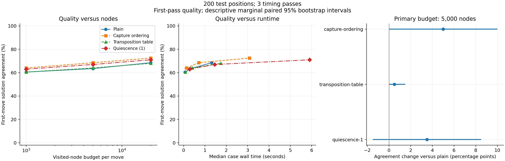

# First tactical quality and search-cost study

Reviewed 2026-10-17. The completed run and automatic analysis finished at
18:05 BST. This memo interprets the frozen study; it does not change its
protocol, settings, source labels or results.

## Main finding

Capture ordering achieved the highest first-move solution agreement of the four
implementations at each tested node budget. At the primary 5,000-node budget it
matched 137 of 200 accepted solutions, versus 127 for plain search, while its
median paired runtime was 2.24 times plain search. This is an observed quality
versus cost trade-off in this implementation, not evidence that capture ordering
is universally slower or that it improves overall playing strength.

The main practical lesson is that fixed visited-node comparisons and runtime
comparisons answer different questions. A feature can help allocate search work
while adding enough per-node overhead to change the apparent value of that help.

## Frozen primary comparison

200 held-out, disjoint source-game/position groups; 5,000 visited nodes per move;
the same material evaluation; one search feature changed at a time. Quality is
the first pass. Runtime is the median paired ratio of each position's median
over three timing passes, with plain search as reference.

| Variant | Accepted first moves | Agreement | Change versus plain | Descriptive paired 95% interval | Paired runtime ratio |
| --- | ---: | ---: | ---: | --- | ---: |
| Plain alpha-beta | 127 / 200 | 63.5% | reference | — | 1.00x |
| Capture ordering | 137 / 200 | 68.5% | +5.0 pp | [0.0, +10.0] pp | 2.24x |
| Transposition table | 128 / 200 | 64.0% | +0.5 pp | [0.0, +1.5] pp | 1.23x |
| Quiescence depth 1 | 134 / 200 | 67.0% | +3.5 pp | [-1.5, +8.5] pp | 4.53x |

Capture ordering uniquely agreed with the source on 18 cases where plain did
not; plain uniquely agreed on 8. For quiescence those counts were 16 and 9; for
the transposition table 1 and 0. Thus a net improvement does not mean every
changed decision improved. The cache's interval is based on one discordant case:
it does not establish that caching cannot hurt on unseen positions.

Intervals are prespecified paired percentile bootstrap intervals (10,000 shared
resamples, seed 20261018). They are descriptive marginal intervals across three
comparisons, without significance or family-wise coverage claims. In
particular, the ordering interval reaches zero and the quiescence interval
crosses zero; these results should not be described as proven population gains.

## Budget curves and what they do not establish

| Nodes per move | Plain | Capture ordering | Transposition table | Quiescence depth 1 |
| ---: | ---: | ---: | ---: | ---: |
| 1,000 | 60.5% | 64.0% | 60.5% | 63.0% |
| 5,000 | 63.5% | 68.5% | 64.0% | 67.0% |
| 20,000 | 68.5% | 72.5% | 68.0% | 71.0% |

These other budgets are exploratory, as prespecified. Capture ordering at 5,000
nodes and plain search at 20,000 nodes both agreed on 137 positions in aggregate,
with different median costs. This is not an equal-time experiment and does not
imply that they solved the same positions. The runtime plot uses aggregate
medians, not per-position equal-clock budgets. No minimum compute threshold,
speedup at equal playing strength or new Elo rating follows from these curves.

## Integrity audit

- All 7,200 scheduled searches completed: 200 positions x four variants x three
  node budgets x three timing passes. No failed or missing search cases.
- Total visited nodes: 62,400,000, including quiescence and partial iterations.
- No depth-zero fallback occurred. Repeated decisions and search statistics
  matched in all 2,400 position/configuration/budget conditions.
- Source setup positions, complete legal solution lines and accepted-move
  sets were independently rechecked for all 200 positions.
- Re-running the analysis reproduced `analysis.json` byte for byte. An
  independent raw-record audit reproduced counts, timing medians and primary
  paired differences. See `audit.json` and `scripts/audit_tactical_results.py`.
- No test result was used to change the frozen configurations or labels.

There were recording failures: a Windows metadata replacement error interrupted
the first timing pass, and restart-only recovery also encountered it. Recovery
at 2,235 saved cases used the original engine snapshot plus a separately hashed
logging-writer amendment. All recorded cases were retained. Source snapshots,
amendment code/hashes, old failure records and warmup/session notes are preserved.
These operational failures must accompany any presentation of runtime results.

The post-hoc per-pass median paired ratios at 5,000 nodes were approximately
2.27/2.25/2.24 for ordering, 1.24/1.23/1.23 for caching and 4.58/4.53/4.48 for
quiescence. Similar ratios across passes are a useful robustness check, not a
replacement for the primary three-pass statistic or proof that interruptions
had no effect. No pass or position was excluded for timing reasons.

## What quality means here

There is no reinforcement-learning reward in this study. Terminal utility,
the material search heuristic and external source-move agreement are separate.
A larger internal material score is not treated as a better research outcome.

Some illustrative source-label misses involve quiet pawn advances, endgame king
moves, sacrifices and longer forcing sequences. For example, source `JQDw6`
accepts `b7`, while the four implementations select `Ke3` or `Nd7` at the primary
budget; source `gZ8sE` accepts `Rg7+`, which quiescence selects while the others
select `Ra8`. These are observed choices, not independently adjudicated tactical
proofs. Finite horizons and material-only evaluation are possible explanations;
the examples alone do not establish a causal failure taxonomy.

Source puzzles are selected for tactics and have fallible engine-generated
labels. First-move agreement does not measure full puzzle solving, alternative
near-equivalent moves, calibrated position values, game outcomes or general
playing strength. FEN cannot restore earlier repetition history. The effective
quality sample size remains 200; timing repeats are not extra independent data.

## Next bounded task

Post-study profiling on the first five **development** positions at 5,000 nodes
provides an implementation lead. Under cProfile, capture ordering invoked
`ChessState.is_capture` 182,366 times, with 7.093 cumulative seconds inside a
12.521-second profiled run. Quiescence invoked it 385,277 times, with 14.775
cumulative seconds inside a 24.537-second profiled run. The wrapper checks
terminal state and move legality for each capture classification. Caching's
`transposition_key` was called 3,167 times, with 1.639 cumulative seconds inside
a 6.736-second profiled run.

These are profiler observations on a small development subset, not unprofiled
benchmark timings or measured speedups. Cumulative times include nested calls
and cannot be added across overlapping functions. They support investigating
repeated terminal/legality checks and key construction; they do not prove which
optimisation would be safe or effective. Exact profiling source and summary are
retained in `development-profile-source.txt` and
`development-profile-summary.json`; raw pstats/configuration/provenance files
are in ignored `artifacts/development-profile-20261017/`.

The recommended continuation is an implementation-efficiency investigation on
development positions, preserving evaluator, move ordering, search decisions
and node accounting. Repeated legal/terminal checks and history-key construction
are concrete candidates to profile before selecting a change. Do not claim an
optimisation or speedup until it is implemented, verified and measured.

The alternative is to broaden external quality assessment with a separately
specified reference-engine protocol. That would address ambiguity of accepted
first moves but adds reference-budget and adjudication choices. Neither path
requires neural training. The next research direction remains a user decision.

The current test split is now observed. Any later tuning or selection must be
kept separate from fresh confirmatory test positions; this run remains frozen
as the original baseline result. No novelty is claimed, no paid compute was
used, and no commit has been made.
